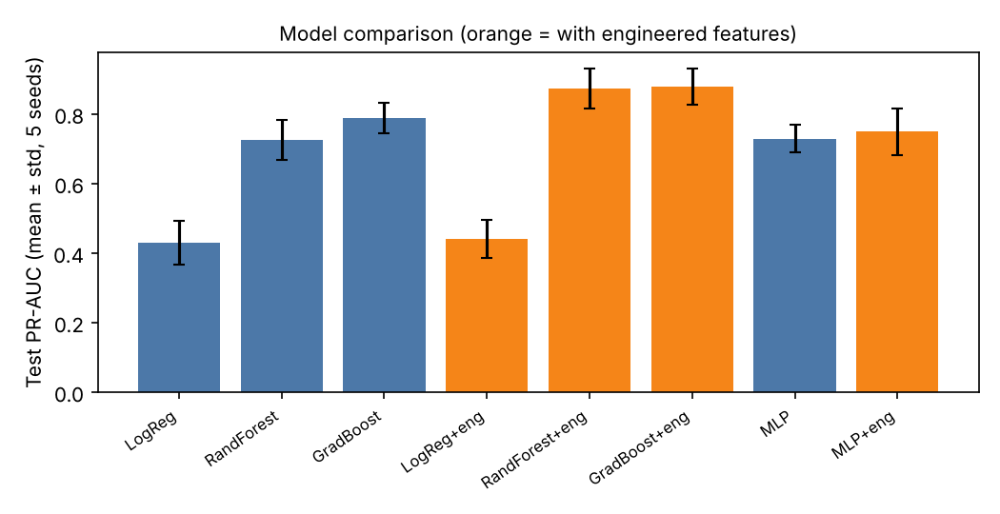
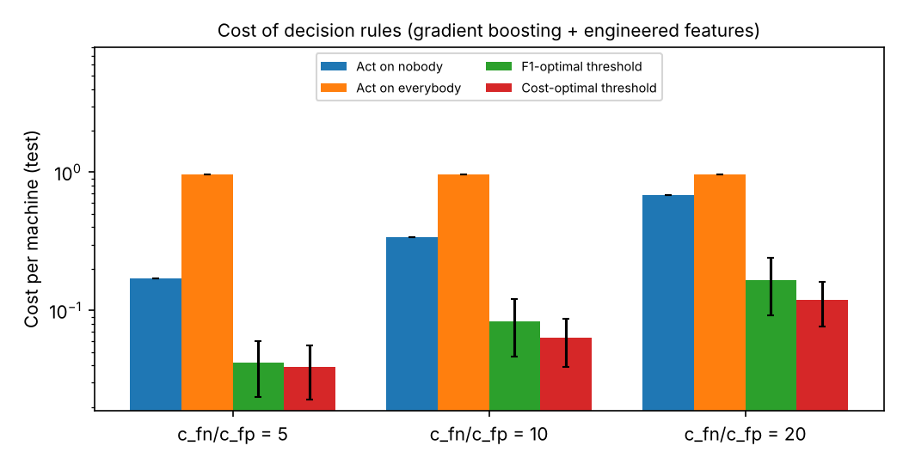
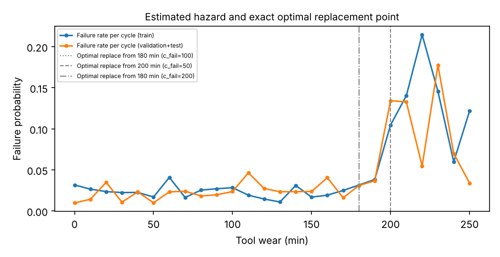
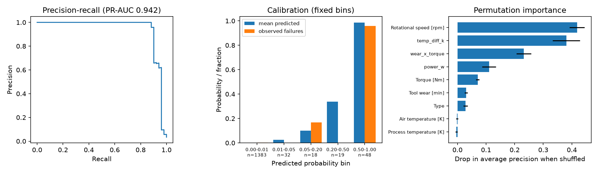

# Industrial Predictive Maintenance

[](https://github.com/RezaManzour/industrial-predictive-maintenance/actions/workflows/ci.yml)

Failure prediction and maintenance decisions on the
[AI4I 2020 Predictive Maintenance dataset](https://archive.ics.uci.edu/dataset/601/ai4i+2020+predictive+maintenance+dataset)
(10,000 machine records, about 3.4% failures). The project compares classical machine learning with a PyTorch
neural network under one evaluation protocol, adds cost-aware decision thresholds, and solves a small
tool-replacement problem with tabular Q-learning checked against the exact solution. Everything runs on CPU.

## Key results

All numbers come from code in this repository and are saved in `results/`. PR-AUC on the held-out test split,
mean ± std over 5 split seeds.

| Model | PR-AUC |
|---|---|
| Logistic regression | 0.429 ± 0.063 |
| Random forest + engineered features | 0.873 ± 0.057 |
| Gradient boosting + engineered features | 0.879 ± 0.051 |
| PyTorch MLP + engineered features | 0.749 ± 0.066 |

- Tree models beat logistic regression clearly. Random forest and gradient boosting cannot be ranked against each other.
- Engineered physical features (power, temperature gap, wear x torque) help tree models consistently, in 5 of 5
  seeds. They mirror the rules that generated this synthetic dataset, so this shows the rules can be recovered, not
  that the model would transfer to real plants.
- An untuned MLP is clearly worse than gradient boosting here (0 of 5 seeds better).
- Choosing the decision threshold by cost lowers expected cost compared with the F1-optimal threshold when a missed
  failure is much more expensive than an unnecessary action.
- For tool replacement, a simple wear threshold is almost as good as the exact optimum, and Q-learning does not beat it.





## Limitations

- The dataset is synthetic and its failures follow fixed rules, so high scores do not imply real-world performance.
- Small test set (about 50 failures per split); only 5 split seeds, and test sets overlap across seeds.
- The MLP was not tuned. Costs in the decision and replacement experiments are assumptions.
- The replacement MDP treats independent snapshots as per-cycle hazards, which is a modelling assumption.

Further detail: [`reports/REPORT.md`](reports/REPORT.md), [`reports/MODEL_CARD.md`](reports/MODEL_CARD.md), [`reports/DATA_CARD.md`](reports/DATA_CARD.md).

## Data findings (from `results/eda_summary.json`)

- 10,000 rows, 339 failures (3.39%), no missing values, no duplicate rows.
- Failure rate by product type: L 3.92%, M 2.77%, H 2.09%.
- Linear correlation with failure is weak (torque 0.19, tool wear 0.11), so relationships are non-linear.
- Air and process temperature are strongly correlated with each other; torque and rotational speed are
  strongly negatively correlated.
- Label quirks: 9 failures have no failure-mode flag, and 18 rows have a mode flag but no recorded failure.
- The dataset is synthetic and its failures follow fixed rules. High scores here show that a model can recover
  those rules, not that it would transfer to real plant data.

## Classical results (single split, seed 42; see multi-seed table below for the number to cite)

Intervals are 95% bootstrap percentile intervals on the test set (1,000 resamples), from
`results/metrics_classical.json`. The threshold is chosen on validation data only.

| Model | PR-AUC | F1 |
|---|---|---|
| Logistic regression | 0.394 [0.274, 0.523] | 0.433 [0.314, 0.543] |
| Random forest | 0.841 [0.744, 0.920] | 0.777 [0.675, 0.862] |
| Gradient boosting | 0.897 [0.821, 0.958] | 0.869 [0.791, 0.933] |
| Logistic regression + engineered | 0.461 [0.335, 0.595] | 0.457 [0.344, 0.554] |
| Random forest + engineered | 0.938 [0.879, 0.987] | 0.938 [0.880, 0.982] |
| Gradient boosting + engineered | 0.942 [0.885, 0.989] | 0.918 [0.857, 0.972] |

What the intervals support: tree models are clearly better than logistic regression, which cannot capture the
non-linear failure rules. Random forest and gradient boosting cannot be ranked against each other, and the gain
from engineered features is large in the point estimates but the marginal intervals overlap, so a paired
comparison over several seeds is needed before calling it significant.

## Multi-seed results (5 seeds, mean +/- std over splits)

From `results/metrics_multiseed.json`. Each seed uses a different stratified split and model seed. Test sets
overlap across seeds, so this is a stability check and not a significance test.

| Model | PR-AUC | F1 |
|---|---|---|
| Logistic regression | 0.429 +/- 0.063 | 0.415 +/- 0.023 |
| Random forest | 0.725 +/- 0.056 | 0.684 +/- 0.037 |
| Gradient boosting | 0.788 +/- 0.043 | 0.720 +/- 0.025 |
| Logistic regression + engineered | 0.441 +/- 0.054 | 0.429 +/- 0.050 |
| Random forest + engineered | 0.873 +/- 0.057 | 0.861 +/- 0.063 |
| Gradient boosting + engineered | 0.879 +/- 0.051 | 0.850 +/- 0.072 |

Paired differences in PR-AUC (engineered minus base): logistic regression +0.012 (better in 4/5 seeds),
random forest +0.148 (5/5), gradient boosting +0.090 (5/5). Random forest minus gradient boosting with
engineered features: -0.005 +/- 0.038 (random forest better in 2/5).

Conclusions the data supports: engineered features help both tree models consistently, with no real effect on
logistic regression, and the two tree models are indistinguishable. The seed-42 table above (PR-AUC about 0.94 with
engineered features) was a favourable split; the multi-seed mean is about 0.87-0.88, and that is the number to cite.

## Deep model results (PyTorch MLP, CPU, 5 seeds)

From `results/metrics_deep.json`. Same splits, protocol and seeds as the multi-seed classical table. The network
is a 64-32-1 MLP with dropout 0.1, class-weighted loss, Adam (lr 1e-3), early stopping on validation PR-AUC. No
hyperparameter tuning was done.

| Model | PR-AUC | F1 |
|---|---|---|
| MLP | 0.729 +/- 0.040 | 0.682 +/- 0.044 |
| MLP + engineered | 0.749 +/- 0.066 | 0.686 +/- 0.064 |
| Gradient boosting + engineered (reference) | 0.879 +/- 0.051 | 0.850 +/- 0.072 |

Paired difference in PR-AUC, MLP + engineered minus gradient boosting + engineered: -0.130 +/- 0.029, with the
MLP better in 0 of 5 seeds.

What this supports: with these untuned settings the MLP is clearly worse than gradient boosting on this dataset,
and is roughly on par with an untuned random forest without engineered features. Engineered features help the MLP
little (+0.02 PR-AUC, smaller than the seed-to-seed spread). This is a result for one small architecture on about
240 training failures, not a general statement about deep learning; a tuned or differently designed network was not tried.

## Cost-aware thresholds (hist_gb + engineered features, 5 seeds)

Cost per machine on the test split, mean ± std over seeds, from `results/cost_thresholds.json`. A missed failure
costs `c_fn` and an unnecessary action costs 1. These costs are assumptions, so three ratios are shown.

| c_fn / c_fp | Act on nobody | Act on everybody | F1-optimal threshold | Cost-optimal threshold |
|---|---|---|---|---|
| 5 | 0.170 ± 0.000 | 0.966 ± 0.000 | 0.042 ± 0.018 | 0.039 ± 0.016 |
| 10 | 0.340 ± 0.000 | 0.966 ± 0.000 | 0.083 ± 0.037 | 0.063 ± 0.024 |
| 20 | 0.680 ± 0.000 | 0.966 ± 0.000 | 0.166 ± 0.074 | 0.118 ± 0.042 |

Choosing the threshold by cost instead of F1 lowers the average cost, by little at ratio 5 (inside the seed spread)
and more at ratios 10 and 20. Both are far cheaper than acting on nobody or on everybody. The seed-to-seed spread is
large, so these are indications from one dataset and not a precise saving.

## Tool-replacement policy (tabular Q-learning vs exact solution)

`src/ipm/rl.py` defines a small MDP over tool-wear bins (10 minutes each) with two actions, keep running or replace
the tool. The per-cycle failure probability at each wear level is estimated from AI4I rows, which are independent
snapshots and not time series, so treating that rate as a per-cycle hazard is a modelling assumption. Costs are
assumed. Because the MDP is tiny and known, the exact optimum is computed by value iteration and used to check
Q-learning. The "held-out" environment uses hazards estimated from the validation and test splits (about 100 failures
over 26 bins), so it is noisy.

| Costs (failure / replacement) | Policy | Cost per cycle, training-hazard env | Cost per cycle, held-out-hazard env |
|---|---|---|---|
| 100 / 10 | Run to failure | 4.825 | 3.423 |
| 100 / 10 | Best fixed replacement (wear bin 20) | 2.675 | 2.594 |
| 100 / 10 | Exact optimum (value iteration) | 2.654 | 2.575 |
| 100 / 10 | Q-learning (mean of 5 seeds) | 2.799 | 2.624 |
| 50 / 10 | Run to failure | 2.413 | 1.712 |
| 50 / 10 | Best fixed replacement (wear bin 20) | 1.522 | 1.476 |
| 50 / 10 | Exact optimum (value iteration) | 1.522 | 1.476 |
| 50 / 10 | Q-learning (mean of 5 seeds) | 1.565 | 1.521 |
| 200 / 10 | Run to failure | 9.650 | 6.846 |
| 200 / 10 | Best fixed replacement (wear bin 16) | 4.930 | 4.607 |
| 200 / 10 | Exact optimum (value iteration) | 4.880 | 4.737 |
| 200 / 10 | Q-learning (mean of 5 seeds) | 5.481 | 4.311 |

What this shows:

- The estimated hazard is roughly flat (about 2-3% per cycle) until about 200 minutes of wear and then rises
  to 10-20%. The exact optimum therefore replaces the tool at about 180-200 minutes of wear, depending on the costs.
- A single fixed replacement rule is almost as good as the exact optimum, so a simple wear threshold already
  captures nearly all of the benefit.
- Q-learning (400k steps, not tuned) reaches a policy that is 2-12% more expensive than the exact optimum in the
  training environment, and replaces too often when failures are very costly (200 / 10). It does not beat
  value iteration, which is expected for a small known MDP.
- In the held-out environment some Q-learning results look better than the exact optimum. That comes from noise
  in the held-out hazard estimates (the optimum was computed for the training hazards), not from Q-learning being
  better.
- This is a demonstration of the decision framework on a synthetic dataset, not a deployable maintenance policy.

## Model diagnostics (gradient boosting + engineered features, seed-42 split)

From `results/diagnostics.json`; the model is fitted on the training split and evaluated on the test split.



- On this split, precision stays at 1.0 up to a recall of about 0.88 and then falls. Remember that this split gave a
  higher PR-AUC (0.942) than the 5-seed mean (0.879).
- Permutation importance (drop in average precision): rotational speed 0.418, temperature gap 0.381, wear x torque
  0.232, power 0.110, torque 0.071; the raw air and process temperatures are about 0. The two largest features match
  the heat-dissipation and overstrain failure rules of the dataset.
- Calibration (fixed probability bins, test split of 1,500 rows): the scores are almost two-valued. 1,383 rows
  score below 0.01 (mean predicted 0.0003, observed failure rate 0.0014, 2 failures) and 48 rows score above 0.5
  (mean predicted 0.985, observed 0.958). The 69 rows in between are too few to judge, but in the 0.2-0.5 bin none of
  19 rows failed while about 6 were expected, which hints at overestimated probabilities in the middle range.
  Treat the scores as a ranking and not as calibrated probabilities; recalibration (Platt or isotonic on validation
  data) was not done.
- Rotational speed, torque and power are strongly related, so permutation importance divides credit among them and
  should not be read as a causal ranking. Raw temperatures show zero importance because their information is carried
  by the temperature gap.

## How to read the classical results

- **No label leakage.** Features are built from the five sensor columns plus product type only. The target,
  the failure-mode flags (TWF, HDF, PWF, OSF, RNF) and identifiers are removed in `split_xy`, and a unit test
  checks this.
- **The engineered features mirror the rules that generated the labels.** The dataset documentation describes
  failures as threshold rules on mechanical power (torque x angular speed), the process-air temperature gap
  combined with low speed, and tool wear x torque. `power_w`, `temp_diff_k` and `wear_x_torque` encode those
  same quantities, so tree models can split on the rule boundaries almost directly. The jump in PR-AUC with
  these features therefore shows that the generating rules can be recovered, and it is not evidence of
  performance on real machines.
- **Small test set.** The test split has roughly 50 failures, so a single failure moves precision and recall
  noticeably. Differences between random forest and gradient boosting are not claimed as a ranking; use the
  bootstrap intervals in `results/metrics_classical.json`.
- **Threshold sensitivity.** A precision of 1.000 depends on the threshold picked on a validation set with
  about 50 failures and should not be read as a stable property of the model.
- Single split and single seed so far.

## Evaluation protocol

- Stratified 70/15/15 train/validation/test split. The single-split table uses seed 42; the multi-seed, deep, cost
  and RL experiments use split seeds 0-4, with the same seed for every model so comparisons are paired.
- Failure-mode flags (TWF, HDF, PWF, OSF, RNF) and identifiers are never used as features, since they leak the label.
- Primary metric: PR-AUC. Also precision, recall and F1 at a threshold chosen on validation data only.
- Early stopping (MLP) and all thresholds use validation data only.
- The test set is used once per model and seed.

## Setup

Python 3.10 or newer.

```bash
python -m venv .venv && source .venv/bin/activate
pip install -e ".[dev]"
pytest -q
```

Download the data and run the EDA:

```bash
python scripts/download_data.py
python -m ipm.eda
python -m ipm.classical
python -m ipm.multiseed
pip install -e ".[deep]"   # PyTorch (CPU)
python -m ipm.deep
python -m ipm.cost
python -m ipm.rl
python -m ipm.diagnostics
python -m ipm.report   # regenerates the figures from results/
```

`make all` runs lint, tests, every experiment and the figures. `make test` runs the tests with coverage. A `Dockerfile`
builds an image that runs the test suite, and `.pre-commit-config.yaml` enables lint hooks (`pre-commit install`).

## Layout

```
src/ipm/        data, features, models, cost thresholds, RL, report figures
scripts/        data download
tests/          unit tests
results/        saved metrics (JSON)
reports/        figures and written report
```

## Data and reproducibility

The dataset is not redistributed; `scripts/download_data.py` fetches it from the UCI repository. It is described in
S. Matzka, "Explainable Artificial Intelligence for Predictive Maintenance Applications", 2020 Third International
Conference on Artificial Intelligence for Industries (AI4I). Exact package versions used for the saved results are
recorded in `requirements-lock.txt`. Results can differ slightly across library versions.

## License

MIT
